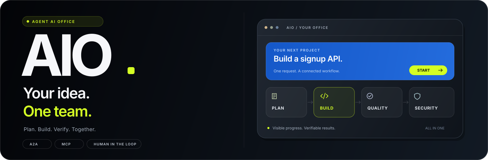
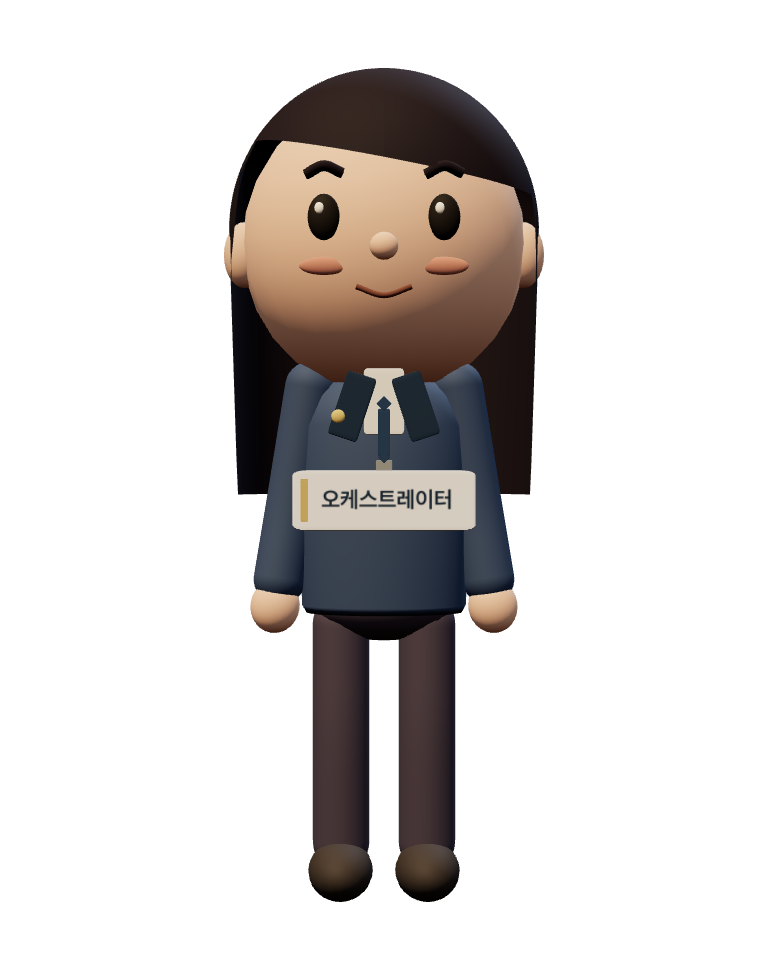
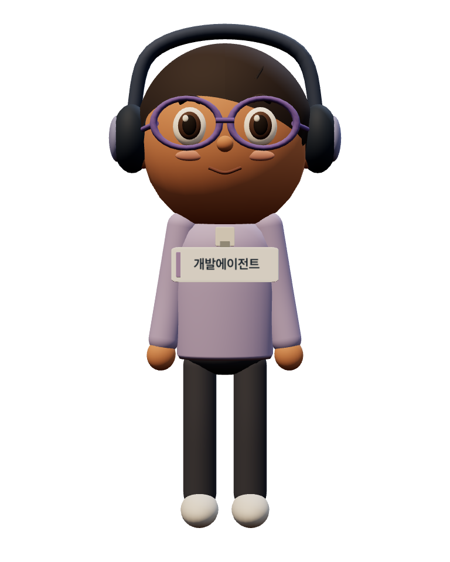
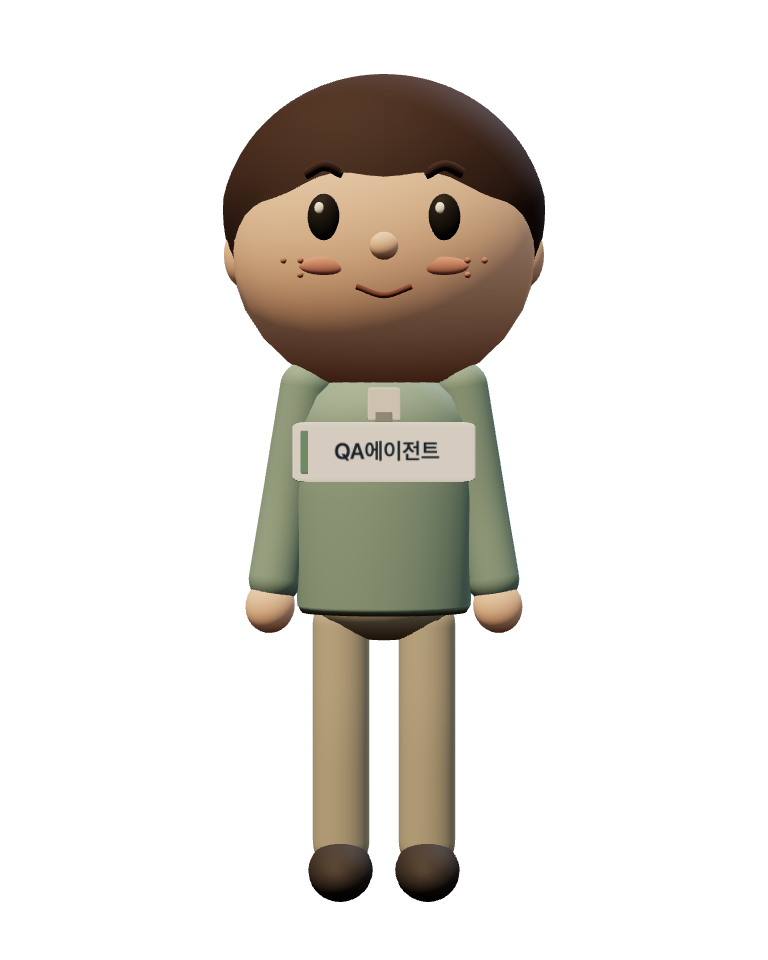
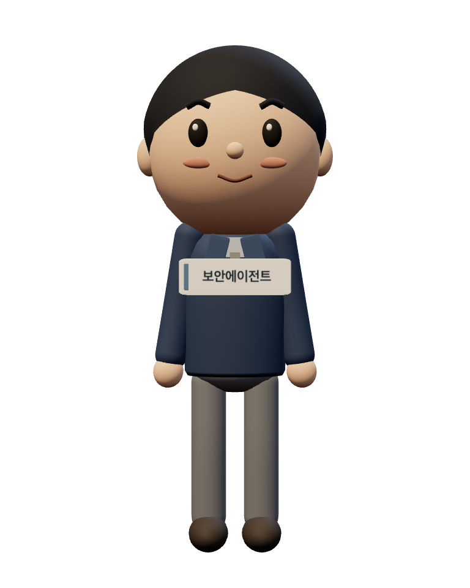
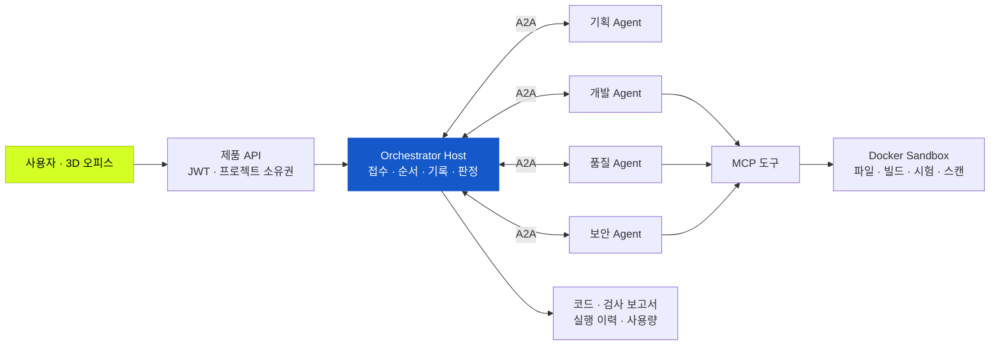

<p align="center">
  
</p>

<h3 align="center">기획, 개발, 품질, 보안까지 All In One.</h3>

<p align="center">
  아이디어를 맡기고, AI 팀의 작업을 확인하고, 필요한 순간 직접 개입하세요.<br />
  <strong>AIO · Agent AI Office</strong>
</p>

<p align="center">
  
  
  
  
  
</p>

<p align="center">
  <a href="#aio는-어떤-프로젝트인가요">소개</a> ·
  <a href="#우리-ai-팀">AI 팀</a> ·
  <a href="#어떻게-동작하나요">구조</a> ·
  <a href="#로컬에서-실행하기">실행하기</a> ·
  <a href="#개발-문서">개발 문서</a>
</p>

---

## AIO는 어떤 프로젝트인가요?

**AIO는 자연어 요청을 기획 → 구현 → 품질·보안 검사 → 수정·재검증으로 연결하는 AI 개발팀입니다.**

코드와 함께 여러 업무를 관리해야 하는 작은 개발팀을 위해, 어떤 직원이 무엇을 하고 있는지 보여주고 질문·중단·후속 수정을 하나의 흐름으로 연결합니다. 산학협력 기업 **㈜텔로스**의 「A2A 기반 다중 AI 에이전트 협업형 가상 소프트웨어 회사」 과제로 시작했습니다.

| 작업이 보이는 오피스 | 필요한 순간의 사용자 개입 | 근거가 남는 결과물 |
| :--- | :--- | :--- |
| 3D 직원과 실제 진행 기록으로 현재 작업을 확인합니다. | 직원별 질문에 답하고, 작업을 중단하거나 이전 결과를 이어 수정합니다. | 코드·빌드·검사·수정 이력을 같은 코드 버전으로 연결합니다. |

## 우리 AI 팀

<table>
  <tr>
    <td align="center" width="20%"><br /><strong>팀장</strong><br /><sub>Orchestrator</sub></td>
    <td align="center" width="20%"><br /><strong>기획</strong><br /><sub>Planner</sub></td>
    <td align="center" width="20%"><br /><strong>개발</strong><br /><sub>Developer</sub></td>
    <td align="center" width="20%"><br /><strong>품질 검사</strong><br /><sub>QA</sub></td>
    <td align="center" width="20%"><br /><strong>보안 검사</strong><br /><sub>Security</sub></td>
  </tr>
  <tr>
    <td align="center">일을 배정하고<br />진행·판정을 관리해요.</td>
    <td align="center">요구사항과<br />작업 순서를 정리해요.</td>
    <td align="center">코드를 만들고<br />문제를 수정해요.</td>
    <td align="center">요청대로 작동하는지<br />시험해요.</td>
    <td align="center">정보 보호와<br />취약점을 확인해요.</td>
  </tr>
</table>

화면에는 다섯 캐릭터가 있습니다. 실제 Multi 구성은 **코드로 동작하는 Orchestrator + 네 개의 LLM Agent**입니다. 팀장은 별도의 다섯 번째 LLM Agent가 아닙니다.

### 업무가 진행되는 공간

<p align="center">
  
  <br />
  <sub>서비스에 사용하는 오피스 배경입니다. 실제 화면에서는 이 공간에 직원·작업 상태·글라스 패널이 함께 표시됩니다.</sub>
</p>

## 어떻게 동작하나요?

> “이메일과 비밀번호로 회원가입 API를 만들어줘.”

1. **접수** — 제품 서버가 사용자·프로젝트 권한을 확인하고 Host에 작업을 전달합니다.
2. **기획** — Planner가 요구사항과 작업 순서를 정리합니다.
3. **개발** — Developer가 코드를 작성하고 실제 빌드 결과를 제출합니다.
4. **검사** — QA와 Security가 **같은 코드 Snapshot**을 병렬로 검사합니다.
5. **수정·판정** — 문제가 있으면 개발에 되돌리고 새 코드로 재검사합니다. Host가 실행 근거를 모아 최종 판정합니다.



**A2A**는 작업·상태·산출물을 주고받는 통신, **MCP**는 Agent가 파일·빌드·검사 도구를 호출하는 연결입니다. **Snapshot**은 검사할 코드를 특정 시점에 고정한 복사본입니다.

## 주요 기능

| 기능 | 구현 내용 |
| --- | --- |
| 실제 진행 시각화 | Run·Step·Trace를 직원 상태와 문서 전달에 연결 |
| 작업 제어 | 직원별 작업 확인, 질문 답변, 중단, 기존 코드·실패 기록을 받는 후속 수정 |
| 안전한 접수 | 서비스 인증, 승인 실행 설정, 멱등 키 기반 중복 방지와 접수 복구 |
| 버전이 일치하는 검사 | Source·빌드·QA·보안 결과의 버전·해시·실행 근거 대조 |
| 역할별 도구 | 파일 읽기·쓰기·Patch, Build, 단위·브라우저 테스트, 정적 보안 검사 |
| 격리 실행 | Docker의 읽기 전용 Source, 네트워크·권한·자원·시간 제한 |
| 실행 기록 | Run·Task·Artifact·Issue·Trace·사용량과 비용의 영속 저장 |
| 사용자·프로젝트 | JWT 인증, 프로젝트 이력, 선택 Run 복원, Source ZIP 다운로드 |

일반 서비스 요청과 고정 회원가입 비교 실험은 경로를 분리했습니다. 서비스에서는 코드 변경이 없는 제출도 새 빌드·검사를 거칩니다. `FINISHED`는 실행 종료이며 성공·실패·미검증 판정과 구분합니다.

### Single과 Multi 비교

| Single Agent | Multi Agent |
| --- | --- |
| 한 Agent가 같은 대화 맥락에서 기획·개발·QA·보안을 순차 수행 | 네 역할 Agent가 각자 맥락으로 작업하고 QA·보안은 병렬 검사 |
| 단계별 도구 권한 전환 | 역할별 도구 권한 분리 |

같은 모델·요구사항·시작 코드·예산·독립 최종 시험으로 비교합니다. 개발 중 **공통 보호시험을 제공하는 조건(Ver1)**과 **자체 시험으로 개발하는 조건(Ver2)**을 교차해 네 조건을 사용했습니다. 두 조건 모두 QA·보안 검사를 수행합니다.

실제 OpenAI 통신 검증과 코드 생성·독립 평가 기록을 보관하고 있습니다. Single Ver1·Multi Ver1 각각 최종 9개 시험을 통과한 단회 사례가 있으며, 이후 실행의 실패·미평가도 함께 기록했습니다. 반복 안정성과 구조별 성능은 모델·코드 판본·표본 수를 구분해 해석합니다.

## 기술 스택

| 영역 | 기술 |
| --- | --- |
| Frontend | React 19 · Vite 8 · JavaScript/JSX · CSS · WebGL 3D |
| Product API | FastAPI · SQLAlchemy · SQLite · JWT |
| Agent platform | Python 3.10+ · FastAPI · HTTPX · Pydantic · OpenAI Responses API |
| 통신·계약 | A2A · MCP stdio · JSON Schema · SHA-256 |
| 실행·검사 | Docker · Python unittest/pytest · Playwright · Bandit |
| 도구·협업 | uv · npm · Git/GitHub · Notion |

## 로컬에서 실행하기

### 화면부터 보기

Node.js 22.12 이상과 npm을 준비한 뒤 저장소 루트에서 실행합니다.

```bash
cd frontend
npm ci
npm run dev
```

개발 서버가 출력한 주소로 접속합니다. 기본 주소는 **http://localhost:5173**입니다. 로그인·프로젝트 조회·실제 Agent 작업에는 아래 서버와 설정이 필요합니다.

### 전체 서비스 준비

Python 3.10+, uv, Node.js/npm, Docker Desktop을 준비합니다. 아래 명령은 **저장소 루트 기준**입니다. 기존 가상환경이 있다면 생성 단계는 생략합니다.

```bash
uv sync --frozen
python3 -m venv backend/.venv
backend/.venv/bin/python -m pip install -r backend/requirements.txt
npm ci --prefix frontend
```

루트 `.env`는 `.env.example`을 참고해 준비하고, 기존 값은 유지합니다.

| 설정 | 용도 |
| --- | --- |
| `OPENAI_API_KEY` | 서버의 OpenAI 호출 |
| `JWT_SECRET` | 사용자 로그인 토큰 서명 |
| `A2A_HOST_API_TOKEN` | 제품 서버와 Host의 공통 서비스 토큰 |
| `A2A_PLATFORM_{PLANNER,DEVELOPER,QA,SECURITY}_TOKEN` | 실제 변수 네 개로 각각 설정하는 Agent 인증 토큰 |
| `A2A_HOST_BASE_URL` | 로컬 Host 주소 `http://127.0.0.1:8002` |

추가로 다음 **로컬 실행 설정과 실제 Docker 이미지·시작 코드**가 준비되어야 합니다. 예시 JSON을 복사하는 것만으로 준비가 끝나지는 않습니다.

| 설정 파일 | 고정할 내용 |
| --- | --- |
| `configs/owned-runtime.local.json` | 모델·Agent 주소·호출/토큰/시간 한도·키를 읽을 환경변수 |
| `configs/owned-tools.local.json` | Docker 이미지·허용 도구·실행 Profile |
| `configs/owned-source.local.json` | 시작 Repository·Commit·Snapshot·의존성 Lock 해시 |

Docker를 켜고 실제 설정과 이미지·Source가 일치하는지 확인합니다. 상세 준비는 [실행 설정](docs/38-owned-runtime-configuration.md) · [Sandbox 이미지](docs/39-sandbox-image-tool-profiles.md) · [시작 코드](docs/40-approved-starting-source.md)에 정리했습니다.

```bash
.venv/bin/python scripts/run_local_service.py check-host
```

### 터미널 3개에서 시작

```bash
# 1. Host + Planner / Developer / QA / Security
.venv/bin/python scripts/run_local_service.py host
```

```bash
# 2. 제품 API
A2A_HOST_READS_ENABLED=true .venv/bin/python scripts/run_local_service.py product
```

```bash
# 3. 프론트엔드
VITE_PRODUCT_RUN_SUBMISSION_ENABLED=true npm --prefix frontend run dev -- --host 127.0.0.1 --port 5173
```

| 서비스 | 로컬 포트 |
| --- | --- |
| 브라우저 화면 | **5173** |
| 제품 API | **8000** |
| Orchestrator Host | **8002** |
| Planner / Developer / QA / Security | **8101 / 8102 / 8103 / 8104** |

브라우저에서 **http://127.0.0.1:5173**으로 접속해 로그인하고 프로젝트 이름·요청을 입력합니다. 종료할 때는 각 터미널의 `Ctrl+C` 후 Docker Desktop을 종료합니다.

<details>
<summary><strong>연결이나 접수가 안 된다면</strong></summary>

- **실행 가능한 시나리오를 확인할 수 없음:** 제품 API·Host가 실행 중인지, 공통 토큰과 승인 설정이 맞는지 확인합니다.
- **실제 업무 요청 연결 비활성:** 프론트의 `VITE_PRODUCT_RUN_SUBMISSION_ENABLED=true`, 제품의 `A2A_HOST_READS_ENABLED=true`를 확인합니다.
- **접수 결과 불확실:** 같은 요청의 접수 상태 조회로 복구합니다. 새 작업을 연속 생성하지 않습니다.
- **질문/입력 대기:** 해당 직원의 현재 질문에 답합니다. 종료된 실패 작업은 `이어서 수정·재시도`로 연결합니다.
- **API 키 변경:** 키를 읽는 Host·Agent 프로세스에 새 환경변수가 적용되어야 합니다.

</details>

## 저장소 구성

```text
frontend/          React · 3D 오피스 · 작업 제어
backend/           사용자 인증 · 프로젝트 · Host 중계
src/orchestrator/  실행 관리 · 상태 · 인계 · 판정
src/agents/        네 역할 Agent · Single · LLM · Host 조립
src/mcp_tools/     파일 · Build · 테스트 · 보안 도구
src/diagnostics/   실제 통신 · 원문/응답 · 지연 관측
src/evaluation/    독립 평가 · 보호시험 · 비교 지표
configs/           승인 설정·정책 예시
schemas/           산출물·계약 JSON Schema
tests/             플랫폼 회귀 검사
design/            디자인 시안
docs/              개발 기록 · 보고서 · 발표자료
```

## 개발 문서

| 찾는 내용 | 문서 |
| --- | --- |
| 역할별 전체 실행·설정 인계 | [플랫폼 실행 안내](docs/45-owned-platform-handoff.md) |
| Host와 제품 서버의 HTTP 계약 | [제품 API 인계](docs/88-host-product-api-handoff.md) |
| 직원 확인·질문·중단 | [사용자 작업 제어](docs/owner-work-controls.md) |
| 기존 코드와 실패를 이어 수정 | [후속 수정 흐름](docs/123-service-repair-continuation.md) |
| 변경 없는 제출·새 검사 | [서비스 제출 정책](docs/126-service-unchanged-submission.md) |
| 통신 무결성·내용·지연 | [실제 OpenAI 통신 보고서 PDF](docs/reports/agent-communication-revalidation-2026-11-13/revalidation-report.pdf) |
| 독립 평가 실행과 지표 | [평가 모듈](src/evaluation/README.md) |
| 발표자료 | [통합 HTML](docs/Presentation/capstone-presentation-draft.html) · [28장 편집 원본](docs/Presentation/editable-slides/README.md) |
| 초기 구현부터의 상세 기록 | [이전 README 개발 이력](docs/README-development-history.md) |

## 함께 만든 사람들

| 이주호 | 송세화 | 강석민 |
| :--- | :--- | :--- |
| Orchestrator · Agent/MCP · Single · 실행/통합 보완 | Frontend · 제품 Backend · 3D 오피스 · 사용자/프로젝트 | Evaluation · 독립 QA/Security · 보호/최종 시험 · 비교 실험 |

---

<p align="center">
  <strong>AIO</strong><br />
  <sub>한 번의 요청에서, 함께 완성하는 과정까지.</sub>
</p>
